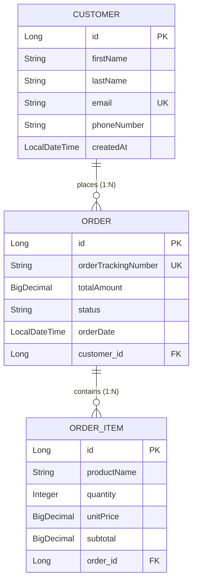

# Implementation Plan - Spring Boot REST API & Hibernate / JPA Persistence (Module 04)

Build a robust, production-ready RESTful web service using **Spring Boot 3 (Java 17)**, **Spring Data JPA**, **Hibernate**, and **Jakarta Bean Validation**, supporting full CRUD operations across relational entities (`@OneToMany`, `@ManyToOne`), custom JPQL queries (`@Query`), and automated MockMvc integration tests.

## User Review Required

> [!IMPORTANT]
> - **Technology Stack**:
>   - Java 17
>   - Spring Boot 3.2.x (Spring Web, Spring Data JPA, Spring Validation)
>   - In-memory database: H2 (default profile for out-of-the-box local execution and automated testing without requiring external database installation)
>   - Production database configs: Ready-to-use profiles for MySQL (`application-mysql.yml`) and PostgreSQL (`application-postgres.yml`)
>   - Testing: JUnit 5, AssertJ, Spring Boot Test (`MockMvc`)
> - **Project Directory**: `C:\Users\sudhe\.gemini\antigravity\scratch\spring-boot-jpa-rest-api`
> - **Public Deliverable**: Git repository with full source code, MockMvc tests, OpenAPI/Swagger docs or Postman-compatible endpoints, and clear instructions for GitHub push and submission.

---

## Domain & API Architecture

We will implement an **Order & Customer Management REST API** that models real-world business relationships:



### 1. Entity Model & Relationship Mappings
- **`Customer`**:
  - `@Entity`, `@Table(name = "customers")`
  - Unique index on `email`
  - `@OneToMany(mappedBy = "customer", cascade = CascadeType.ALL, orphanRemoval = true, fetch = FetchType.LAZY)`
  - Encapsulated helper methods (`addOrder()`, `removeOrder()`) maintaining bidirectional consistency.
- **`Order`**:
  - `@Entity`, `@Table(name = "orders")`
  - `@ManyToOne(fetch = FetchType.LAZY)` with `@JoinColumn(name = "customer_id", nullable = false)`
  - `@OneToMany(mappedBy = "order", cascade = CascadeType.ALL, orphanRemoval = true, fetch = FetchType.LAZY)`
  - Tracking number, total amount, status (`PENDING`, `CONFIRMED`, `SHIPPED`, `CANCELLED`).
- **`OrderItem`**:
  - `@Entity`, `@Table(name = "order_items")`
  - `@ManyToOne(fetch = FetchType.LAZY)` with `@JoinColumn(name = "order_id", nullable = false)`
  - Item name, quantity ($> 0$), unit price, derived subtotal.

---

### 2. Spring Data JPA Repositories & Custom Queries
- **`CustomerRepository extends JpaRepository<Customer, Long>`**:
  - Custom derived methods: `Optional<Customer> findByEmailIgnoreCase(String email)`, `boolean existsByEmailIgnoreCase(String email)`
  - Custom JPQL queries (`@Query`):
    - `@Query("SELECT c FROM Customer c LEFT JOIN FETCH c.orders WHERE c.id = :id")` (prevents N+1 query problem)
    - `@Query("SELECT c FROM Customer c WHERE LOWER(c.lastName) LIKE LOWER(CONCAT('%', :keyword, '%'))")`
- **`OrderRepository extends JpaRepository<Order, Long>`**:
  - Custom JPQL queries (`@Query`):
    - `@Query("SELECT o FROM Order o WHERE o.customer.id = :customerId ORDER BY o.orderDate DESC")`
    - `@Query("SELECT o FROM Order o WHERE o.status = :status AND o.totalAmount >= :minAmount")`
    - `@Query("SELECT COALESCE(SUM(o.totalAmount), 0) FROM Order o WHERE o.customer.id = :customerId AND o.status = 'CONFIRMED'")`
- **`OrderItemRepository extends JpaRepository<OrderItem, Long>`**

---

### 3. RESTful API Endpoints (`@RestController`)

| Method | Endpoint | Description | Status Code |
|---|---|---|---|
| **POST** | `/api/v1/customers` | Create a new customer (with validation) | `201 Created` |
| **GET** | `/api/v1/customers` | Retrieve all customers (with pagination/sorting) | `200 OK` |
| **GET** | `/api/v1/customers/{id}` | Retrieve customer by ID | `200 OK` / `404 Not Found` |
| **PUT** | `/api/v1/customers/{id}` | Update customer profile | `200 OK` / `404 Not Found` |
| **DELETE** | `/api/v1/customers/{id}` | Delete customer and cascading orders | `204 No Content` |
| **POST** | `/api/v1/customers/{customerId}/orders` | Create order with items for customer | `201 Created` |
| **GET** | `/api/v1/orders/{id}` | Retrieve order details with items | `200 OK` |
| **GET** | `/api/v1/customers/{customerId}/orders` | Retrieve all orders of a customer | `200 OK` |
| **PUT** | `/api/v1/orders/{id}/status` | Update order status | `200 OK` |
| **DELETE** | `/api/v1/orders/{id}` | Cancel/delete an order | `204 No Content` |

---

### 4. Jakarta Validation & Error Handling
- **DTO Validation Annotations**:
  - `@NotNull(message = "First name is mandatory")`
  - `@Size(min = 2, max = 50, message = "First name must be between 2 and 50 characters")`
  - `@Email(message = "Please provide a valid email address")`
  - `@Positive(message = "Quantity must be greater than zero")`
  - `@DecimalMin(value = "0.01", message = "Price must be at least 0.01")`
  - `@Valid` on nested collections (`List<OrderItemRequest>`).
- **Global Exception Handler (`@RestControllerAdvice`)**:
  - `MethodArgumentNotValidException` $\rightarrow$ `400 Bad Request` with structured map of invalid field names and specific error messages.
  - `ResourceNotFoundException` $\rightarrow$ `404 Not Found`.
  - `DuplicateResourceException` $\rightarrow$ `409 Conflict` (e.g. duplicate email).
  - Standard RFC 7807 compliant error response format.

---

## Proposed Changes

### Directory: `C:\Users\sudhe\.gemini\antigravity\scratch\spring-boot-jpa-rest-api`

#### [NEW] [pom.xml](file:///C:/Users/sudhe/.gemini/antigravity/scratch/spring-boot-jpa-rest-api/pom.xml)
- Spring Boot 3.2.3 starter parent
- Dependencies: `spring-boot-starter-web`, `spring-boot-starter-data-jpa`, `spring-boot-starter-validation`, `h2`, `mysql-connector-j`, `postgresql`, `spring-boot-starter-test`.

#### [NEW] Configuration
- `application.yml`: H2 in-memory configuration with JPA DDL auto `update`, SQL console enabled.
- `application-mysql.yml`: Production MySQL connection properties.
- `application-postgres.yml`: Production PostgreSQL connection properties.

#### [NEW] Domain Entities (`com.rabtech.api.entity`)
- `Customer.java`: `@Entity`, `@Table(name = "customers")`, `@OneToMany` to orders.
- `Order.java`: `@Entity`, `@Table(name = "orders")`, `@ManyToOne` customer, `@OneToMany` items.
- `OrderItem.java`: `@Entity`, `@Table(name = "order_items")`, `@ManyToOne` order.
- `OrderStatus.java`: Enum (`PENDING`, `CONFIRMED`, `SHIPPED`, `CANCELLED`).

#### [NEW] DTOs & Validation Payloads (`com.rabtech.api.dto`)
- `CustomerCreateRequest.java`, `CustomerUpdateRequest.java`, `CustomerResponse.java`
- `OrderCreateRequest.java`, `OrderItemRequest.java`, `OrderResponse.java`, `OrderStatusUpdateRequest.java`

#### [NEW] Repositories (`com.rabtech.api.repository`)
- `CustomerRepository.java` (with custom `@Query`)
- `OrderRepository.java` (with custom `@Query`)
- `OrderItemRepository.java`

#### [NEW] Service Layer (`com.rabtech.api.service`)
- `CustomerService.java` & `CustomerServiceImpl.java` (transactions, DTO conversion, validations)
- `OrderService.java` & `OrderServiceImpl.java` (order calculations, stock checks, state changes)

#### [NEW] Controllers (`com.rabtech.api.controller`)
- `CustomerController.java` (`@RestController`, `@RequestMapping("/api/v1/customers")`)
- `OrderController.java` (`@RestController`, `@RequestMapping("/api/v1/orders")`)

#### [NEW] Exceptions & Advice (`com.rabtech.api.exception`)
- `ResourceNotFoundException.java`
- `DuplicateResourceException.java`
- `GlobalExceptionHandler.java` (`@RestControllerAdvice`)
- `ErrorResponse.java`

#### [NEW] Test Suite (`src/test/java/com/rabtech/api`)
- `CustomerControllerIntegrationTest.java`: `MockMvc` tests for GET, POST (valid + invalid email/size 400), PUT, DELETE.
- `OrderControllerIntegrationTest.java`: `MockMvc` tests for creating orders with items, fetching, updating status, cascading deletes.
- `CustomerRepositoryTest.java`: Tests custom `@Query` methods and relationship integrity.

#### [NEW] Documentation & Git Repository
- `README.md`: API architecture documentation, cURL examples, relationship diagram, instructions to run locally and push to GitHub.
- Git repository initialization with clean commit history.

---

## Verification Plan

### Automated Tests
Run full Maven verification and integration tests:
```powershell
& "C:\Users\sudhe\.gemini\antigravity\scratch\tools\apache-maven-3.9.6\bin\mvn.cmd" clean test -f "C:\Users\sudhe\.gemini\antigravity\scratch\spring-boot-jpa-rest-api\pom.xml"
```
Verify:
1. All Spring context loads successfully.
2. 100% passing tests for all CRUD operations via `MockMvc`.
3. Validation constraints properly block invalid inputs and return detailed 400 error payloads.
4. JPA relationships (`@OneToMany`, `@ManyToOne`) and custom `@Query` methods execute flawlessly.
